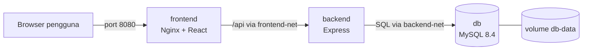
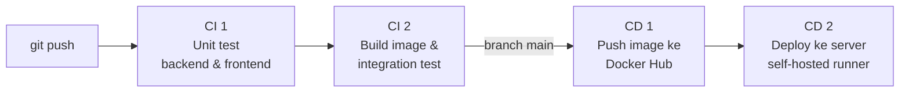

# Daftar Tugas: Deployment Full Stack dengan Docker dan CI/CD

Proyek UTS mata kuliah Pengembangan dan Operasi. Aplikasi web **Daftar Tugas (To-Do List)** full stack yang di-deploy menggunakan **container Docker** dengan pipeline **Continuous Integration (CI)** dan **Continuous Deployment (CD)** menggunakan GitHub Actions.

| Lapisan | Teknologi | Container |
|---|---|---|
| Frontend | React 19 + Vite, disajikan oleh Nginx 1.28 | `uts-todo-frontend` |
| Backend | Node.js 22 + Express 5 (REST API) | `uts-todo-backend` |
| Database | MySQL 8.4 | `mysql:8.4` |

## Anggota kelompok

| NIM | Nama | Peran |
|---|---|---|
| ... | ... | Container (Dockerfile & Docker Compose) |
| ... | ... | Continuous Integration |
| ... | ... | Continuous Deployment |
| ... | ... | Laporan & video |
| ... | ... | Dokumentasi & pengujian aplikasi |

## Cara menggunakan aplikasi

1. Buka aplikasi di browser (`http://localhost:8080` atau alamat server).
2. Tulis tugas baru di kotak isian, lalu klik **Tambah**.
3. Centang kotak di samping tugas untuk menandainya selesai (tugas akan dicoret).
4. Klik **Hapus** untuk menghapus tugas.
5. Footer menampilkan versi frontend, versi backend (commit SHA), dan versi MySQL yang sedang berjalan.

## Arsitektur container



- **Dua network terpisah:** `frontend-net` (frontend ↔ backend) dan `backend-net` (backend ↔ database). Database tidak bisa diakses langsung dari frontend maupun dari luar.
- **Hanya satu port yang dibuka** ke luar: 8080 (frontend). Backend dan MySQL hanya dapat diakses di dalam network Docker.
- **Volume `db-data`** menyimpan data MySQL sehingga data tetap ada walau container dihapus atau di-deploy ulang.
- **Healthcheck** di setiap container; `depends_on: condition: service_healthy` memastikan urutan start: MySQL → backend → frontend.
- **Multi-stage build:** image akhir hanya berisi file yang dibutuhkan (frontend akhir berbasis `nginx:alpine`, backend tanpa dev-dependencies).
- **User non-root** pada container backend, `restart: unless-stopped`, konfigurasi lewat environment variable (`.env`), dan **graceful shutdown** saat `docker stop`.

## Menjalankan dengan Docker (lokal)

Prasyarat: [Docker Desktop](https://www.docker.com/products/docker-desktop/) sudah terpasang dan berjalan.

```bash
# 1. Salin file konfigurasi dan isi password
cp .env.example .env            # Windows PowerShell: copy .env.example .env

# 2. Build image dan jalankan semua container
docker compose up -d --build

# 3. Cek status (tunggu sampai semua "healthy")
docker compose ps

# 4. Buka http://localhost:8080
```

Perintah berguna:

```bash
docker compose logs -f backend                 # melihat log backend
docker compose exec db mysql -u todo -p todo   # masuk ke MySQL (password dari .env)
docker compose down                            # menghentikan container (data tetap ada)
docker compose down -v                         # menghentikan dan menghapus data
```

## Pipeline CI/CD

File: [`.github/workflows/ci-cd.yml`](.github/workflows/ci-cd.yml)



| Tahap | Kapan berjalan | Isi |
|---|---|---|
| **CI 1 - Unit test** | Setiap push & pull request | `npm test` backend (Mocha + Supertest, 10 test) dan frontend (Vitest), lalu build frontend |
| **CI 2 - Integration test** | Setelah CI 1 lolos | `docker compose build`, menjalankan 3 container sampai healthy, lalu `scripts/smoke-test.sh` menguji alur frontend → backend → MySQL (tambah, tandai selesai, hapus, validasi) |
| **CD 1 - Push image** | Push ke `main` setelah CI lolos | Build dan push image ke Docker Hub dengan tag `latest` dan 7 karakter commit SHA |
| **CD 2 - Deploy** | Setelah CD 1 | Di server (self-hosted runner): `docker compose pull` lalu `docker compose up -d --wait`, container diganti dengan versi baru tanpa kehilangan data |

Jika satu tahap gagal, tahap berikutnya tidak dijalankan, sehingga kode yang rusak tidak pernah ter-deploy.

### Setup CI/CD (sekali saja)

1. **Docker Hub:** buat akun di hub.docker.com, lalu **Account settings → Personal access tokens → Generate new token** (akses *Read & Write*). Simpan token-nya.
2. **GitHub → Settings → Secrets and variables → Actions:**
   - Tab **Variables**: `DOCKERHUB_USERNAME` = username Docker Hub
   - Tab **Secrets**: `DOCKERHUB_TOKEN` (token dari langkah 1), `DB_PASSWORD`, `DB_ROOT_PASSWORD` (password database di server)
3. **Server (self-hosted runner):** di laptop/PC yang menjadi server dan sudah menjalankan Docker Desktop:
   - GitHub → **Settings → Actions → Runners → New self-hosted runner**, pilih sistem operasi (misalnya Windows x64)
   - Jalankan perintah yang ditampilkan GitHub di PowerShell (download, `config.cmd`), lalu jalankan runner dengan `./run.cmd`
   - Runner berstatus **Idle** di halaman Runners berarti siap menerima job deploy
4. Push ke branch `main`, lalu pantau di tab **Actions**.

> **Keamanan:** self-hosted runner menjalankan kode dari repository ini. Gunakan repository **private**, atau aktifkan **Settings → Actions → General → "Require approval for all external contributors"** agar pull request dari orang lain tidak bisa menjalankan job di server.

### Demonstrasi CD

1. Ubah sesuatu yang terlihat, misalnya judul di `frontend/src/App.jsx`.
2. `git commit` dan `git push` ke `main`.
3. Buka tab **Actions**: keempat job berjalan berurutan.
4. Setelah job **CD 2 - Deploy** selesai, refresh aplikasi: perubahan tampil dan footer menunjukkan commit SHA yang baru.

## Struktur repository

```
.
├── .github/workflows/ci-cd.yml   # pipeline CI/CD
├── backend/
│   ├── Dockerfile                # multi-stage: deps, test, production (non-root, healthcheck)
│   ├── .dockerignore
│   ├── healthcheck.js            # dipanggil HEALTHCHECK Docker
│   ├── src/                      # config, repository (MySQL/knex), server (REST API), index
│   └── test/api.test.js          # unit test API
├── frontend/
│   ├── Dockerfile                # multi-stage: build (Node) -> Nginx
│   ├── .dockerignore
│   ├── nginx.conf                # sajikan React + reverse proxy /api ke backend
│   └── src/                      # aplikasi React
├── scripts/smoke-test.sh         # integration test end-to-end
├── compose.yaml                  # definisi 3 service, 2 network, 1 volume
└── .env.example                  # contoh konfigurasi (salin menjadi .env)
```

## REST API

| Method | Endpoint | Fungsi |
|---|---|---|
| GET | `/healthz` | Health check backend |
| GET | `/api/info` | Versi backend dan MySQL |
| GET | `/api/todos` | Daftar tugas (terbaru di atas) |
| POST | `/api/todos` | Tambah tugas, body `{"title": "..."}` |
| PATCH | `/api/todos/:id` | Ubah status, body `{"done": true}` |
| DELETE | `/api/todos/:id` | Hapus tugas |

## Sumber referensi

Aplikasi ini dikembangkan dari contoh resmi Docker:

- [docker/awesome-compose: react-express-mysql](https://github.com/docker/awesome-compose/tree/master/react-express-mysql) (lisensi CC0 1.0) sebagai kerangka arsitektur React + Express + MySQL dengan Docker Compose
- Backend contoh tersebut berbasis [node-docker-good-defaults](https://github.com/BretFisher/node-docker-good-defaults) oleh Bret Fisher (lisensi MIT)

Pengembangan yang dilakukan kelompok: fitur CRUD Daftar Tugas (frontend dan backend), migrasi tabel otomatis, unit test, Dockerfile produksi multi-stage dengan user non-root, konfigurasi Nginx reverse proxy, pemisahan network, healthcheck berantai, smoke test, serta pipeline CI/CD GitHub Actions dengan Docker Hub dan self-hosted runner.
